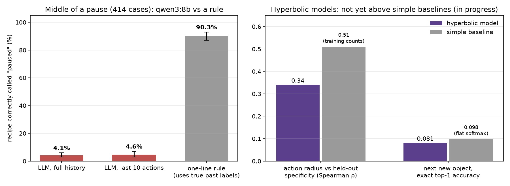
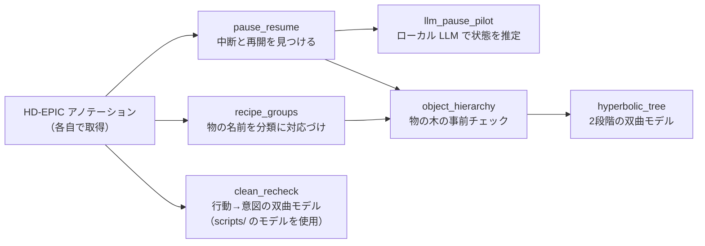

# paused-recipe-tracking

**家庭のキッチンで、人が料理を途中でやめて別のことをし、また戻ってくる場面を AI が追えるかを調べた修士研究のコードです。実際の料理動画データセット（HD-EPIC）から、こうした「中断と再開」を 422 件見つけ、ローカル LLM と双曲空間（hyperbolic）のモデルを単純なベースラインと同じ条件で比べました。**

**ローカル LLM（qwen3:8b）が、中断中のレシピを「中断中」と正しく答えられたのは 4.1%（414 件中）。過去のレシピ名を使う1行のルールなら 90.3%。**



| | |
|---|---|
| **課題** | 料理を手伝う AI は「今なにをしているか」だけでなく、「途中でやめて、あとで戻るレシピ」を覚えておく必要がある。HD-EPIC では **9 人全員・69 レシピ中 57 レシピ**で中断と再開が起きていた（422 件、中断の長さは中央値で 18 アクション・約 41 秒、中断中の作業の 63% は洗い物などの家事） |
| **工夫** | **モデルを作る前に、問題とベースラインを確かめた**：①中断と再開をデータから定義して数える → ②ローカル LLM の限界を測る → ③双曲空間のモデルを、単純な数え上げ・ユークリッド空間・普通の分類器と同じ条件（9 人で1人ずつ抜いて評価、複数シード、対応のある信頼区間）で比べる |
| **成果** | LLM は中断中のレシピの約半分（52%）を「完了」と答えた。双曲モデルは現時点では単純なベースラインを超えていない（行動の具体さ ρ 0.34 vs 数え上げ 0.51、次に取る物 top-1 0.081 vs 0.098）。**問題は空間の形ではなく、入力の手がかりの少なさ**だとわかり、次の方向（文脈・視線・レシピの段階を足す）が決まった。研究は継続中 |

---

## 中断と再開は、全員に・ほとんどのレシピで起きている

HD-EPIC の「レシピの区間」アノテーションを使い、**同じ動画の中で、レシピ R の区間 → R 以外の区間 → また R の区間** という並びを「中断と再開」と定義しました。

| 項目 | 結果 |
|---|---|
| 中断と再開の件数 | **422 件**（9 人中 9 人、69 レシピ中 57 レシピ） |
| 中断の長さ（中央値） | 40.5 秒、18 アクション（ナレーション） |
| 中断中の区間の中身（734 区間） | 家事（洗い物・片付けなど）63.4%、別のレシピ 36.6% |
| 別の動画で再開 | 81 件（中断が動画をまたぐ） |

### 「待ち」の動作のあとに中断しやすい（試験的な結果、定義を固めている途中）

オーブンの扉を閉める、鍋にふたをするなど、「何かが動いている間は離れられる」動作のあとに中断が始まるのでは、と考えました。中断前の最後の 3 アクションに「待ち」の動作がある割合を、同じレシピの普通の 3 アクションと比べています。

| ラベル | 中断の直前 | 普通の区間 | 差 |
|---|---|---|---|
| AI（Claude）が文ごとにつけたラベル | 26.8% | 6.0% | 4.5 倍 |
| **本人が 50 文を確認し、そのラベルで補正** | **13.4%** | **1.9%** | **+11.5 ポイント**（95% 区間 3.4–17.4） |

- AI のラベルをそのまま信じず、本人が 50 文をブラインドで確認しました（一致 65.2%、κ 0.34）。AI が「待ち」とした文のうち本人も同意したのは 9/25 で、AI の定義は広すぎました。
- 補正すると割合は約半分になりますが、「待ち」の定義をどう変えても**中断の直前のほうが多い**（差 +9.8〜+18.8 ポイント、区間はすべて 0 より上）。
- ずれの多くは「オーブンを閉める」のような**待ちにつながる準備の一歩**を数えるかどうか。次は 1 文ではなく、短い動作の並び（入れる → 閉める → タイマー）で判断する定義にする予定です。

## LLM は「中断中」をほとんど見抜けず、「完了」や「未開始」と答える

中断のちょうど真ん中（A）と、再開した瞬間（B）で、その人のそれまでの行動（ナレーション文）とレシピ一覧を qwen3:8b に渡し、各レシピの状態（作業中 / 中断中 / 完了 / 未開始）を JSON で答えさせました（1,658 回、約 2.1 時間、すべて手元の PC）。

| 時点 | 正解 | LLM（全履歴） | LLM（直近 10 行） | 1行のルール※ |
|---|---|---|---|---|
| A：中断の真ん中（414 件） | 「中断中」 | **4.1%**（95% 区間 3–6%） | 4.6%（3–7%） | 90.3%（87–93%） |
| B：再開した瞬間（415 件） | 「作業中」 | 19.3%（16–23%） | 17.3%（14–21%） | 68.9%（64–73%） |

- A で LLM が実際に答えたのは「完了」51.7%、「未開始」32.9%。直近 10 行だけだと「未開始」が 74.6% に増える。
- JSON の形式は 100% 守れたが、自信度はほぼ常に 0.85〜1.0 で、ECE は 0.86（自信過剰）。
- ※ルールは「直前に出てきたレシピが中断中」というもので、**過去の正解ラベル（どの区間がどのレシピか）を使う**。LLM は生の文章だけを見るので公平な比較ではない。ただ、「ラベルさえ追えれば 9 割わかる」ので、**LLM に足りないのは記録をつけ続けること**だと言える。

## 双曲空間は、まだ単純な数え上げに勝てていない（継続中）

双曲空間は木構造（大まか → 具体的）をきれいに埋め込めるので、「意図」や「物の階層」を表すのに向いていると考えました。2 つの方法で、同じデータ・同じ評価で比べています。ここに載せているのは現時点の結果で、研究は進行中です。

| 実験 | 双曲モデル | 比較相手 | 結果 |
|---|---|---|---|
| **行動 → 意図**：フォントと印象タグの階層埋め込み（Kubota et al., arXiv:2604.04158）を「行動の集合 → レシピ」に転用。原点からの距離が「行動の具体さ」を表すか | ρ **0.34**（設定 A、3 シード） | 学習データでの回数を数えるだけ：ρ 0.51 | 9 人中 0 人で双曲が上回った。ユークリッド版よりは +0.11 良い |
| **次に取る物**：物の木（道具/食材 → 分類 → 物）を Poincaré 埋め込み（木の再現 MAP 0.98）し、Busemann プロトタイプで予測 | top-1 **0.081** | 普通の分類器（softmax）：0.098 | 差 −0.015（95% 区間 −0.030〜−0.001）。ユークリッド版と同等。半径で正解を見分ける力も AUROC 0.54 とほぼ偶然 |

**わかったこと**：過去の行動から次の物を当てられるのはどのモデルでも 1 割ほどで、手がかりが弱い。そのためモデルの出力は木の中心付近に集まり、双曲空間の良さが出る余地がない。モデルを作る前に、データだけで「階層で外れを和らげられるか」を確かめた事前チェック（間違えた予測が正しい収納場所に入っている割合 13–16%、ランダムなら 12–13%）とも一致しました。次は、手がかり（文脈・視線・レシピの段階）を強くしたうえで、もう一度双曲空間を試します。

## 構成：解析ごとにフォルダを分け、各スクリプトの冒頭に判断の理由を書いた



| フォルダ | 内容 |
|---|---|
| [`analysis/pause_resume/`](analysis/pause_resume/) | 中断と再開の定義と集計。`validation/` は「待ち」ラベルの確認用シートの作成（`make_sample.py`）と、本人ラベルとの比較・補正（`compare.py`） |
| [`analysis/llm_pause_pilot/`](analysis/llm_pause_pilot/) | 問い合わせの作成（`cases.py`）、Ollama で実行・途中保存・7 時間で停止（`pilot.py`）、集計（`analyze.py`） |
| [`analysis/recipe_groups/`](analysis/recipe_groups/) | 自由記述の物の名前を HD-EPIC の名詞クラスに対応づける（容器と中身、数量語、修飾語の処理） |
| [`analysis/object_hierarchy/`](analysis/object_hierarchy/) | 収納場所の木・意味の木を作り、Naive Bayes と MLP で事前チェック |
| [`analysis/hyperbolic_tree/`](analysis/hyperbolic_tree/) | 段階1：木の Poincaré 埋め込み、段階2：エンコーダを Busemann 損失で学習、ユークリッド・softmax と比較 |
| [`analysis/clean_recheck/`](analysis/clean_recheck/) | 行動→意図の双曲モデルの再検証、損失の診断、円錐（entailment cone）設定の比較 |
| [`scripts/`](scripts/) | 行動→意図の双曲モデル本体（Lorentz モデル、entailment cone） |
| [`results/summary.json`](results/summary.json) | この README の数字（集計値のみ、出典ファイル付き） |

## 実行方法

1. HD-EPIC のアノテーション（[hd-epic/hd-epic-annotations](https://github.com/hd-epic/hd-epic-annotations)）を、このリポジトリ直下の `annotations/` に置く。動画は不要（物の動きの解析だけ、アノテーション内の 3D 情報を使う）。
2. 環境を作る（[`requirements.txt`](requirements.txt)、Python 3.11）。
3. 解析ごとに、上の図の順で実行する。例：

```bash
python analysis/pause_resume/pause_resume.py
python analysis/llm_pause_pilot/cases.py
ollama pull qwen3:8b
python analysis/llm_pause_pilot/pilot.py --test 5     # 5 件で試す（本番は --hours 7）
python analysis/llm_pause_pilot/analyze.py
python docs/make_figure.py                             # results/summary.json から図を作る
```

各スクリプトの冒頭に、入力・出力・決めたこと（誰が決めたか）を書いています。

## データ：HD-EPIC 由来のファイルは一切含めていない

このリポジトリにあるのはコードと集計した数字だけです。アノテーション、ナレーション文を含む表、学習済みの重み、LLM の回答ログは、データセットのライセンスに従い公開していません（`.gitignore` で除外）。

## 限界

- 1 つのデータセット・9 人だけ。中断の件数は 2 人（P03、P09）で全体の約 6 割。
- LLM は 8B のローカルモデル 1 つ、プロンプト 1 種類だけ。大きなモデルや「記録をつけさせる」プロンプトは未検証。
- LLM との比較に使ったルールは正解ラベルを使うので、上限の目安であり、そのまま使える方法ではない。
- 「待ち」の結果は、本人が確認した 50 文だけで補正した試験的な数字。「待ちではない」側の確認が 21 文と少なく、見落とし率はまだ測れていない。
- 双曲モデルは現時点の設定での結果で、研究は継続中。

## 開発の進め方

コードの多くは AI コーディング支援（Claude Code）で書きました。本人が担当したのは、**システムの設計、使う手法の選択、何がうまくいかなくなりうるかの予測と検証**です。表面上はうまくいきそうに見えても、深く調べると効かないアイデアが多かったため、単純なベースラインとの比較や、AI がつけたラベルの手作業での確認（上の「待ち」の検証など）で一つずつ確かめました。各スクリプトの冒頭に、どの判断を誰がしたかを残しています。

## 参考文献

- Kubota, Shiku, Uchida. *Hierarchical Co-Embedding of Font Shapes and Impression Tags.* arXiv:2604.04158, 2026.
- Perrett et al. *HD-EPIC: A Highly-Detailed Egocentric Video Dataset.* 2025.
- Desai et al. *Hyperbolic Image-Text Representations* (MERU). 2023.
- Nickel, Kiela. *Poincaré Embeddings for Learning Hierarchical Representations.* 2017.
- Ghadimi Atigh, Keller-Ressel, Mettes. *Hyperbolic Busemann Learning with Ideal Prototypes.* 2021.

<!-- TODO(Jason): ライセンスを決める（MIT で良いか） -->

---

## English

**Code from my master's research: can an AI keep track of a recipe that a person leaves halfway and comes back to later? From a real home-cooking dataset (HD-EPIC) I found 422 such pause-and-resume events, then compared a local LLM and hyperbolic-space models against simple baselines under the same conditions.**

**A local LLM (qwen3:8b) called the paused recipe "paused" in only 4.1% of 414 cases. A one-line rule using the past recipe labels gets 90.3%.**

| | |
|---|---|
| **Problem** | A cooking assistant must remember recipes that are paused, not only what is happening now. In HD-EPIC, pauses happen for **all 9 people and 57 of 69 recipes** (422 events; median pause 18 actions / about 41 s; 63% of the time in between is housework such as washing up). |
| **Approach** | **Check the problem and the baselines before building the model:** (1) define and count pause-and-resume events; (2) measure what a local LLM can do; (3) compare hyperbolic models with counting, Euclidean and flat-softmax baselines under identical conditions (leave-one-person-out over 9 people, several seeds, paired confidence intervals). |
| **Result** | The LLM called about half of the paused recipes "finished". So far the hyperbolic models do not beat simple baselines either (action specificity ρ 0.34 vs counting 0.51; next-object top-1 0.081 vs 0.098). **The bottleneck is weak input evidence, not the geometry of the output space**, which set the next direction: add context, gaze and the current recipe step. Work in progress. |

**Pauses tend to start after a "waiting" action (preliminary).** With the AI assistant's per-sentence labels, 26.8% of pauses have a waiting-type action (closing the oven, putting a lid on) among the last 3 actions, vs 6.0% of ordinary stretches. I checked 50 of those labels blind (agreement 65.2%, κ 0.34; I agreed with only 9 of its 25 "waiting" labels). Corrected to my labels: 13.4% vs 1.9% (+11.5 points, 95% CI 3.4–17.4), and pauses stay ahead under every definition tried (+9.8 to +18.8 points). Next: judge short action sequences (put in → close → timer) instead of single sentences.

**LLM pilot.** At the middle of a pause (A) and at the resume (B), qwen3:8b received the person's narrations so far and their recipe list, and gave each recipe's state as JSON (1,658 queries, about 2.1 h, all local). A: "paused" 4.1% (full history) / 4.6% (last 10 lines); B: "active" 19.3% / 17.3%. At A it mostly answered "finished" (51.7%) or "not started" (32.9%). JSON was always valid, but confidence was almost always 0.85–1.0 (ECE 0.86). The rule baseline (the most recent recipe is the paused one) uses true past labels, so it is an upper reference, not a fair competitor.

**Hyperbolic models.** (1) Action → intention: an adaptation of hierarchical font–impression co-embedding (Kubota et al., arXiv:2604.04158) to action sets → recipes. The radius tracks how specific an action is with ρ 0.34, below simply counting training uses (0.51, better in 0 of 9 people), though +0.11 above the Euclidean version. (2) Next object: a two-stage model, a Poincaré embedding of the object tree (MAP 0.98), then an encoder trained with Busemann prototypes. Top-1 0.081 vs 0.098 for a flat softmax (paired difference −0.015, 95% CI −0.030 to −0.001), equal to the Euclidean control; the radius barely separates right from wrong (AUROC 0.54).

**Run.** Put the HD-EPIC annotations (github.com/hd-epic/hd-epic-annotations) in `annotations/`, install `requirements.txt` (Python 3.11), then run each analysis in the order of the diagram (Ollama with qwen3:8b for the LLM pilot). Each script's header lists its inputs, outputs and decisions.

**Data.** Code and aggregate numbers only. No annotations, tables with narration text, trained weights or LLM answer logs are included, in line with the dataset license.

**Limitations.** One dataset with 9 people (two people account for about 60% of the pauses). One 8B LLM and one prompt. The rule baseline uses true labels. The waiting result is corrected from only 50 hand-checked sentences, and the miss rate is not yet measured. The hyperbolic results reflect the current settings; the work continues.

**How it was built.** Most of the code was written with an AI coding assistant (Claude Code). My part was the system design, choosing the methods, predicting what could go wrong, and checking it. Many ideas look right on the surface but do not hold up, so each one was tested against simple baselines and by hand-checking the AI's labels (as in the waiting check above). Each script's header records who made which decision.
